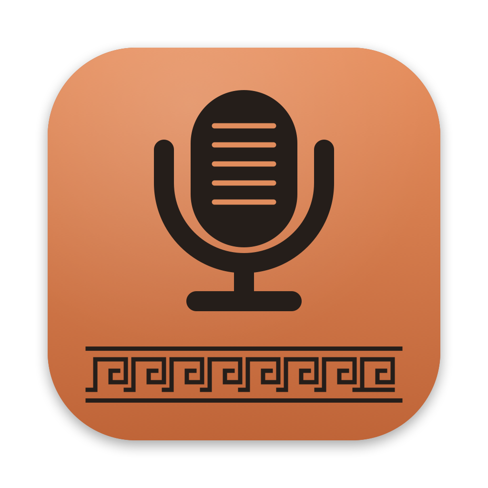

<p align="center"></p>

<h1 align="center">Phaedrus</h1>

<p align="center"><b>Press 🎤, speak, and your words appear at the cursor in any Mac app.<br>
Speech recognition runs entirely on your Mac.</b></p>

<p align="center"><a href="https://venzellucas.github.io/phaedrus/">Website &amp; installation guide</a></p>

> …writing is unfortunately like painting; for the creations of the painter have the attitude
> of life, and yet if you ask them a question they preserve a solemn silence.
>
> (Socrates, in Plato's *Phaedrus* 275d, translated by Benjamin Jowett)

Socrates never wrote anything down; he talked. Phaedrus lets you talk and still end up with text.

## Features

- **On-device.** Uses Apple's `SpeechAnalyzer` / `SpeechTranscriber` (macOS 26). No cloud service, no API key, no subscription. Your audio never leaves the Mac.
- **Optional language detection.** Starts with English (US). Select up to three languages in settings to listen in all of them and keep the transcript that fits best.
- **Experimental language mixing.** Optionally combine words from the selected languages in one dictation, without translating them. This runs on-device and is off by default.
- **Optional Smart cleanup.** Apple Intelligence chooses recognized alternatives using sentence context. Natural removes spoken repetitions and fillers; Written also corrects grammar, spelling, and likely recognition mistakes. Runs on-device, with a time limit and automatic fallback. Off by default.
- **Quiet recording UI.** A smooth colored ribbon responds to microphone input, with elapsed time and all selected language codes. No distracting live transcript.
- **Change languages while dictating.** Press ⌘, to pause and open Settings. Resume with new languages while keeping your earlier words.
- **No Accessibility permission, no admin rights.** Text is inserted through a macOS *Service*, so it also works on managed Macs where you can't grant Accessibility.
- **Stays out of the way.** No Dock icon and no menu-bar item. It starts when you press the key and quits after 15 idle minutes.

## Requirements

- macOS 26 (Tahoe) or later
- Xcode Command Line Tools with the macOS 26 SDK or later (`xcode-select --install`)

## Install

```sh
git clone https://github.com/venzellucas/phaedrus.git
cd phaedrus
scripts/build.sh                  # builds and installs ~/Applications/Phaedrus.app
open ~/Applications/Phaedrus.app  # opens the settings
```

In the settings window, turn on **Use the 🎤 key to dictate**. This makes the 🎤 key (F5 on
Mac laptops) send F18, binds F18 to Phaedrus, and keeps the remap after restarts. Other
key remaps you have made with `hidutil` are kept.

If your keyboard has no 🎤 key, click **Change shortcut in System Settings…** and give
**Keyboard Shortcuts → Services → Text → Dictate with Phaedrus** any shortcut you like.

The first dictation asks for microphone access. Each language's speech model is downloaded
from Apple once; the bubble shows the download progress.

### Download a test build

For **Apple silicon Macs running macOS 26 or later**, the latest successful
[Build workflow](https://github.com/venzellucas/phaedrus/actions/workflows/build.yml)
on `main` includes a `Phaedrus-macOS-arm64.zip` download under **Artifacts**.
Sign in to GitHub to download it; test builds expire after 30 days.

Extract the ZIP and move `Phaedrus.app` into `~/Applications` before opening it.
If Phaedrus is already running, stop it first (`pkill -x Phaedrus` in Terminal).
These builds are **ad-hoc signed, not notarized**. macOS may block the first launch;
if you trust the download, follow Apple's
[Open Anyway instructions](https://support.apple.com/en-us/102445)
in System Settings → Privacy & Security. Managed Macs may restrict this option.
Then open Phaedrus's settings and configure your shortcut as above.

## Use

1. Click into a text field.
2. Press **🎤**. A rounded recording panel appears and you hear a *tink*.
3. Speak. The colored ribbon responds to microphone input; a timer confirms the session is running. Text stays hidden until you finish. If audio buffers stop arriving, the panel says **Microphone interrupted**.
4. To stop, press **🎤** again, press **Return**, click the bubble, or stay quiet for 3 seconds.
   **Esc** cancels, also while the bubble still says "Starting…".

To change languages while recording, press **⌘,** (Command-comma). Phaedrus stops the
microphone, finishes the current segment, and opens Settings with the language choices
at the top. **Return**, **Resume dictation**, or closing the settings window resumes with
the new selection. The panel's timer continues counting recording time, excluding the pause.
All segments are inserted together only when you finish.

While paused, **Finish and insert** (⌘Return) inserts the words already captured, and
**Esc** / **Cancel dictation** discards the entire dictation. A failed restart preserves
earlier segments and reopens Settings so you can retry or finish. The original macOS
Service has a time limit; a paused session shows a warning in its final minute and then
finishes with the saved text before that limit is reached.

The text replaces the current selection, if there is one. While the bubble is visible,
Return and Esc go to Phaedrus during recording; in paused Settings, Return resumes and
Esc cancels. Command-comma is captured globally only while a recording is starting or running.

A few apps don't accept text from Services (some Electron-based apps, for example). With
**Also copy the text to the clipboard** turned on (the default), just press ⌘V there.

## Settings

Open **Phaedrus** from Spotlight or Finder:

You can also use **⌘,** while Phaedrus is focused. To open Settings from other apps, even
when Phaedrus is not running, assign a shortcut to **Phaedrus Settings** in
**System Settings → Keyboard → Keyboard Shortcuts → Services**. This is separate from
the dictation shortcut; no global shortcut is assigned automatically.

| Setting | Default |
|---|---|
| Shortcut: 🎤 key, or any shortcut | 🎤 key off until you enable it |
| Languages (up to 3) | English (US) |
| Mix languages in one dictation (experimental) | off |
| Use on-device Smart cleanup (experimental) | off |
| Review style | Conservative (Natural and Written are optional) |
| Stop after silence | 3 s |
| Give up if nothing is heard | 10 s |
| Longest dictation | 5 min (up to 15) |
| Also copy the text to the clipboard | on |
| Start and stop sounds | on |

The settings are stored in the `io.github.venzellucas.phaedrus` defaults domain.
The language default applies to fresh installs; updating preserves your saved selection.
To switch an existing install to English only, deselect the other languages in settings.

### Mixing Portuguese and English

Select Portuguese and English, then enable **Mix languages in one dictation (experimental)**.
For example, the intended result for “Preciso fazer o deploy hoje” keeps “deploy” in English.
With mixing disabled, the best whole-recording transcript still wins.

Mixing aligns finalized words by their audio timestamps and replaces short spans only when
another language has substantially higher confidence and covers the same speech. Missing
timing, incomplete results, or ambiguous matches retain the original transcript. It does
not translate or rewrite what you said.

This is a conservative heuristic, not guaranteed bilingual recognition. The language models'
confidence scores may disagree even when both are wrong; borrowed words, names, and rapid
switches still need testing with real speech. If you pause to find a word, increasing **Stop
after silence** can help avoid finishing the recording too soon.

### Smart cleanup with Apple Intelligence

Enable **Use on-device Smart cleanup (experimental)** in Settings. The settings show whether
Apple Intelligence and all selected languages are available on this Mac. Enable language
mixing too if you want the model to choose between Portuguese/English alternatives. Choose
**Review style → Natural** to also clean up spoken repetitions, fillers, and abandoned starts.
Choose **Written** for light grammar, spelling, and contextual recognition corrections.
The saved style defaults to **Conservative**, preserving the previous behavior.

**Check availability** shows a result dialog even when the status hasn't changed. It checks
readiness; it doesn't enable Apple Intelligence or download its model. If Apple Intelligence
is off, click **Open System Settings…**, choose **Apple Intelligence & Siri**, and turn it on.
Return to Phaedrus after macOS has prepared the model; availability refreshes when the app
becomes active. Once ready, turn on the Smart cleanup switch. Cleanup runs after dictation,
not when you click Check availability. Unsupported selected languages are listed by name.

After speech recognition finishes, the panel may briefly say **Refining…**. In the conservative
stage, the local model receives short disputed passages, recognized alternatives and confidence scores,
and nearby sentence context. It returns option IDs, never replacement prose. Phaedrus then
assembles the selected recognition tokens and checks their audio boundaries again. High-confidence
words, numerals, capitalized names, and common code/URL spellings are conservatively protected.
Conservative punctuation cleanup only adds a missing final `.`, `?`, or `!`. With mixing off,
Conservative can only add this final punctuation.

One request reviews at most six disputed passages, with a bounded prompt. Additional passages
retain the existing transcript, so long dictations are never truncated. Unavailable models,
unsupported languages, refusal, invalid output, and inference errors keep the existing result.
Conservative waits at most five seconds for the model, then uses that same fallback.

**Natural** adds a pass over the resulting text, even for a single selected language or a
transcript without word timings. It can turn “Eu, tipo, eu queria fazer o deploy, né.” into
“Eu queria fazer o deploy.” This is an illustrative target, not a guaranteed model result.
The model decides which words are disfluencies based on context; “tipo” in “esse tipo de
mudança” and intentional emphasis should remain. It can remove words and adjust punctuation
and capitalization; it cannot add words, paraphrase, reorder clauses, or translate the text.

Natural processes short chunks (up to 120 whitespace-separated words / 1,800 UTF-8 bytes),
with a **ten-second total budget**, including the conservative stage. It preserves paragraph
separators, completed valid edits, and every unprocessed or rejected chunk. Long dictations
may therefore be only partially reviewed. Fresh model sessions keep context bounded.
Validation rejects obvious truncation, empty output, excessive cuts, new or reordered words,
and changes to detected names, numbers, negations, and technical identifiers. These checks
cannot prove that a cut preserves meaning. Natural may remove an intended word; review the
result and switch back to Conservative when you need a closer transcript.

If a rewrite is rejected, Natural can still retain model-requested cuts of adjacent,
unpunctuated stutters such as “eu eu” or “the the”. These partial edits are reconstructed
from the original text; unclear recognition, names, numbers, negations, and punctuated
repetitions stay intact. Capitalized discourse markers such as “So” and “Just” are not
automatically treated as proper names. The model still decides whether they are fillers.

**Written** turns speech into lightly edited written text. It can replace words and add
grammar words, while aiming to keep the speaker's grammatical person, tone, meaning,
language switches, and order of ideas. For example, “Eu tô testando pra ver se eles vai
entender” can become “Eu estou testando para ver se eles vão entender.” “Eu lavei o carro”
must remain in first person, rather than becoming narration about a named person. These
examples describe the intended behavior, not measured model accuracy.

Written reuses bounded chunks and has a **fifteen-second total budget**. It keeps useful
contextual recognition choices but skips a separate punctuation-only request. Validation
checks explicit speaker markers, detected names, numbers, negations, technical identifiers,
retained content-word order, and the size and similarity of local edits. It allows contractions,
agreement fixes, word splits, capitalization, and paragraph breaks; unrelated additions,
obvious summaries, translations, and truncation are rejected. Rejected rewrites can retain
the same limited stutter cuts as Natural; every unprocessed part remains present.

These are heuristic checks, not proof that the meaning is unchanged. The local model can
guess the wrong word, and a valid edit can still change a nuance. Written is optional and
experimental: review the output. It works from the recognized text, not the audio, and does
not promise the same quality as another app's transcription or language model.

All three styles run entirely on the Mac; no server, API key, or separately managed model is needed.

This is experimental. A contextually plausible choice can still be wrong, and the model cannot
hear the original audio. Compare enabled/disabled results on your own recordings before relying
on it. Requires Apple Intelligence to be enabled with its local model ready; dictation itself
continues to work without Apple Intelligence.

## Privacy

- Audio is processed on the Mac by Apple's speech framework. Speech models are downloaded
  from Apple. Optional Smart cleanup uses Apple Intelligence's system-managed local model;
  this app never sends audio or transcripts to a cloud model.
- Transcripts are not stored or logged. The debug log (below) records lengths, timings,
  review style, and whether cleanup changed the text; it never includes the text itself.
- The clipboard copy is marked for this Mac only, so Universal Clipboard does not send it to
  your other devices. Clipboard-manager apps can still record it; turn the copy off if that matters to you.

## How it works

| File | What it does |
|---|---|
| `Sources/Engine.swift` | Microphone → `AVAudioEngine` → one `SpeechAnalyzer` with a `SpeechTranscriber` per language. The highest-confidence transcript is the baseline; optional mixing uses finalized timed words. Auto-stop combines microphone level with transcription activity. |
| `Sources/TranscriptMerger.swift` | Conservative alignment and confidence-based replacement of spans across languages. Incomplete or misaligned alternatives leave the baseline intact. |
| `Sources/CleanupPlan.swift` | Bounded alternative choices, protected words, prompt construction, and validation/reconstruction of model choices. |
| `Sources/SmartCleanup.swift` | Optional on-device Foundation Models integration and availability checks. |
| `Sources/CleanupDeadline.swift` | Cancellation and a deadline that also returns promptly when inference ignores cancellation. |
| `Sources/FluencyCleanup.swift` | Natural review style, bounded text chunks, deletion/punctuation validation, and preservation of unprocessed text. |
| `Sources/WrittenCleanup.swift` | Written review instructions and structural checks for local grammar/spelling edits, speaker markers, protected details, and idea order. |
| `Sources/HUD.swift` | Rounded recording panel, microphone-driven ribbon, elapsed time, and listening/finishing/error states. Respects Reduce Motion and Increase Contrast. |
| `Sources/App.swift` | Dictation/Settings Services, temporary global keys, pause/resume, and the session loop. Carbon hotkeys are released while editing Settings, and a fresh recognizer uses the new selection on resume. |
| `Sources/SettingsView.swift` | The SwiftUI settings window. |
| `scripts/mic-key.sh` | `on`/`off`: remaps the 🎤 key (HID usage `0xC000000CF`) to F18 with `hidutil` and installs a LaunchAgent that re-applies it at login. Bundled in the app and used by the settings toggle. |
| `scripts/make-icon.swift` | Draws the icon, a black-figure Greek pottery style. `scripts/make-icon.sh` rebuilds `Resources/AppIcon.icns`. |

Why a Service? A Service returns text straight to the focused app, so Phaedrus needs no
Accessibility permission to type or paste. The trade-off is that apps without Services
support can't receive it directly, hence the clipboard copy.

### Debugging

```sh
PHAEDRUS_DEBUG=1 ~/Applications/Phaedrus.app/Contents/MacOS/Phaedrus --once
```

This runs one dictation from the terminal. The debug log on stderr has lengths and timings
only. The transcript itself is printed to stdout, since that is what the test is for.

## Uninstall

```sh
scripts/uninstall.sh
```

This removes the 🎤 remap and its login item, the app, the Services shortcut, the settings
and the microphone permission. If you delete the app by hand, run `scripts/mic-key.sh off` first.

## Limitations

- Mixed-language dictation is experimental and off by default. It can improve switches only when one of the selected recognizers supplies better words with usable timing; it cannot recover words that every recognizer misses.
- The app is ad-hoc signed and built from source. After a rebuild, macOS may ask for microphone access again.

## Contributing

Bug reports and small, focused pull requests are welcome. See [CONTRIBUTING.md](CONTRIBUTING.md)
for build instructions, manual checks, and what to include in a report.

## License

[MIT](LICENSE)
